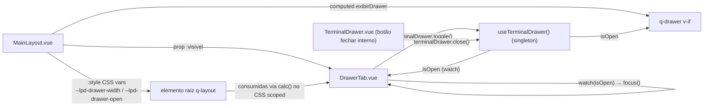
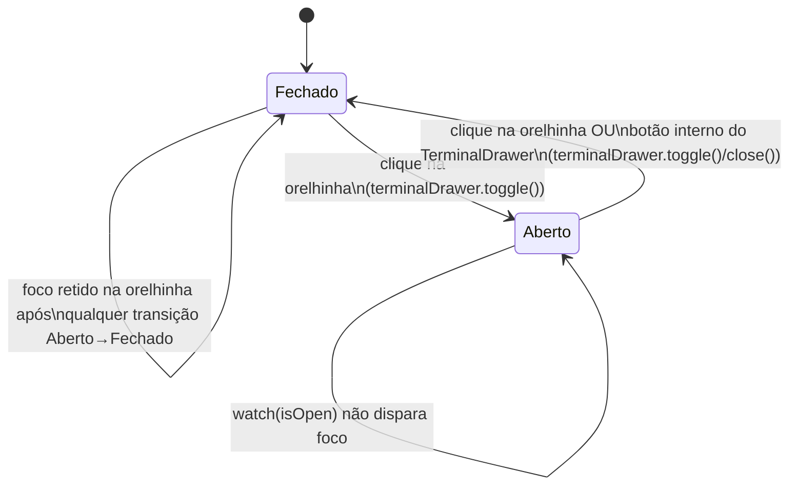

# PLAN — Orelhinha: toggle sticky do drawer do visualizador

## Dados do Plano

| Campo               | Valor                                |
| ------------------- | ------------------------------------- |
| Número da US        | US34                                   |
| Slug                | `us34-orelhinha-drawer-visualizador`   |
| Stack               | Quasar + Vue 3 + TypeScript + Vitest   |
| Data de criação     | 2026-11-20                             |
| Data de modificação | —                                      |

---

## Resumo Técnico

Substituir o botão de toggle do `AppHeader` (US15) por uma "orelhinha" — um `q-btn` fino, fixo, grudado na borda do `q-drawer` do visualizador — em um novo componente `DrawerTab.vue`, montado como sibling do `q-drawer` dentro do `MainLayout`. O desacoplamento de posição entre `MainLayout` (que calcula `drawerWidth` e possui `terminalDrawer.isOpen`) e `DrawerTab` (que precisa saber onde grudar) é feito via **CSS custom properties no elemento raiz** (`--lpd-drawer-width`, `--lpd-drawer-open`), evitando prop drilling de layout. A condição de visibilidade (rota `cnab-240` + viewport ≥ 600px) permanece como computed local em `MainLayout.vue`, agora passada como prop `visivel` para `DrawerTab`. A animação de abertura/fechamento reaproveita a transição nativa do `q-drawer`, recalibrada via `:deep()` para ~0.2s ease, suprimida com `!important` sob `prefers-reduced-motion: reduce` — sem composable novo, só CSS. O `AppHeader` perde o botão e a store de visualização de US15 permanece intocada.

---

## Componentes Afetados

| Componente             | Ação      | Notas                                                                                          |
| ---------------------- | --------- | ------------------------------------------------------------------------------------------------ |
| `DrawerTab.vue`         | Criar     | Orelhinha: `q-btn` fixo, ícone/tooltip/aria dinâmicos, foco retido ao fechar (RN04, RN05, RN07) |
| `MainLayout.vue`        | Modificar | Monta `DrawerTab` sibling do `q-drawer`; expõe CSS vars `--lpd-drawer-*`; recalibra transição    |
| `AppHeader.vue`         | Modificar | Remove o botão de toggle do visualizador e o computed `exibirToggleVisualizador` (RN01)          |
| `DrawerTab.spec.ts`     | Criar     | Testes de ícone/aria/tooltip/foco/visibilidade (unitário)                                        |
| `MainLayout.spec.ts`    | Modificar | Novos casos: `DrawerTab` presente/ausente conforme rota/breakpoint, CSS vars aplicadas            |
| `AppHeader.spec.ts`     | Modificar | Remove os testes do botão de toggle do visualizador (US15), que não existe mais                  |
| `useTerminalDrawer.ts`  | Sem alteração | Continua singleton puro — nenhuma lógica de rota/breakpoint é adicionada aqui (decisão da entrevista, Q3) |
| `TerminalDrawer.vue`    | Sem alteração | Botão de fechar interno (RN02) já existe e continua chamando `useTerminalDrawer().close()`       |
| `us34-orelhinha-drawer-visualizador.spec.ts` (E2E) | Criar | Sticky real durante scroll, transição visual, `prefers-reduced-motion`, navegação por teclado    |

---

## Estrutura de Dados

Nenhum tipo novo de domínio. A única "estrutura de dados" desta US é o contrato de props do componente novo:

```ts
// src/components/DrawerTab.vue — defineProps

interface DrawerTabProps {
  /**
   * `true` quando a orelhinha deve ser renderizada: mesma condição usada pelo
   * `q-drawer` em MainLayout (rota `cnab-240` + viewport >= 600px, RN08).
   * Calculada em MainLayout.vue (computed `exibirDrawer`), não duplicada aqui.
   */
  visivel: boolean;
}
```

Nenhum estado novo em composable/store. `DrawerTab` consome `useTerminalDrawer()` diretamente (mesmo padrão do antigo botão em `AppHeader`) para `isOpen`/`toggle`.

CSS custom properties expostas por `MainLayout.vue` no elemento raiz do `q-layout` (consumidas por `DrawerTab.vue`, não por nenhum outro componente):

| Variável               | Tipo              | Significado                                                             |
| ----------------------- | ----------------- | ------------------------------------------------------------------------ |
| `--lpd-drawer-width`    | `<length>` (px)   | Largura atual do drawer (mesmo valor de `drawerWidth`, já existente)     |
| `--lpd-drawer-open`     | `0` ou `1`        | Espelha `terminalDrawer.isOpen.value` — usado em `calc()` no CSS da orelhinha |

---

## Lógica Principal

1. **Visibilidade (RN08, Q3)** — `MainLayout.vue` já calcula `exibirDrawer` (rota `cnab-240` + `$q.screen.gt.xs`). Esse mesmo computed passa a ser usado em dois lugares: `v-if` do `q-drawer` (já existe) e prop `:visivel="exibirDrawer"` do novo `<DrawerTab />`. `AppHeader.vue` remove seu computed duplicado (`exibirToggleVisualizador`) e o botão inteiro — RN01.
2. **Posicionamento via CSS vars (Q2/Opção C)** — `MainLayout.vue` aplica `:style` reativo no elemento raiz do `q-layout` (ou num wrapper dedicado) com `'--lpd-drawer-width': drawerWidth + 'px'` e `'--lpd-drawer-open': terminalDrawer.isOpen.value ? 1 : 0`. `DrawerTab.vue` usa essas variáveis em seu próprio CSS scoped (`right: calc(var(--lpd-drawer-open) * var(--lpd-drawer-width))` ou equivalente) para ficar grudado na borda esquerda do drawer quando aberto e na borda da viewport quando fechado — sem receber `drawerWidth` como prop.
3. **Ícone/tooltip/aria dinâmicos (RN04, RN05, CA03, CA04)** — `computed` dentro de `DrawerTab.vue`: `icone` (`chevron_left` fechado / `chevron_right` aberto — Q6, consistente com o `chevron_right` já usado no botão interno do `TerminalDrawer`), `tooltipTexto` ("Ver arquivo" / "Ocultar arquivo"), `ariaLabel` (mesmo texto do tooltip), `ariaExpanded` (`terminalDrawer.isOpen.value` como string `'true'`/`'false'`).
4. **Toggle (RN01)** — clique em `DrawerTab` chama `terminalDrawer.toggle()`. Não há lógica própria de abrir/fechar fora do singleton existente.
5. **Retenção de foco (RN07, CA08, Q4)** — `DrawerTab.vue` mantém uma `template ref` (`orelhinhaRef`) no `q-btn` e um `watch(() => terminalDrawer.isOpen.value, (open) => { if (!open) orelhinhaRef.value?.$el?.focus(); })`. Como reage à *mudança de estado* (não ao clique), funciona independente de qual botão disparou o fechamento — orelhinha ou botão interno do `TerminalDrawer` (RN02).
6. **Animação (RN06, CA06/CA07, Q8)** — `MainLayout.vue` sobrescreve a transição nativa do `q-drawer` via `:deep(.q-drawer) { transition: width 0.2s ease, transform 0.2s ease !important; }` (ou seletor equivalente que o Quasar realmente usa internamente — validar no DevTools durante implementação). Mesmo tratamento aplicado ao `transition: right 0.2s ease` de `DrawerTab.vue`. Bloco `@media (prefers-reduced-motion: reduce)` em ambos os componentes sobrescreve com `transition: none !important` (Q7/Q8 — CSS puro, sem composable, sem JS de detecção).
7. **Botão interno do `TerminalDrawer` (RN02)** — nenhuma mudança de código; já existe e já chama `useTerminalDrawer().close()`. Esta US só garante (via item 5) que o foco acompanhe o fechamento disparado por ele também.

---

## Composables / Serviços

- `useTerminalDrawer()` (existente, **sem alteração**) — `DrawerTab.vue` consome `isOpen`/`toggle` diretamente, igual ao padrão anterior do `AppHeader`. Decisão da entrevista (Q3): nenhuma lógica de rota/breakpoint é adicionada a este composable — ele permanece estado puro, sem depender de `vue-router`/`quasar`.
- Nenhum composable novo é criado (decisão da entrevista, Q7, descartando `usePrefersReducedMotion()` em favor de CSS puro).

---

## Eventos e Props

`DrawerTab.vue`:

- **Props:** `visivel: boolean` (controla `v-if` no próprio componente ou no `v-if` de quem o monta — a decidir pelo `frontend-developer` qual camada aplica o `v-if`, mas a prop deve existir independente disso para que `MainLayout` continue sendo a única fonte da regra RN08).
- **Emits:** nenhum — `DrawerTab` consome `useTerminalDrawer()` diretamente e não precisa comunicar nada ao pai.
- **Interação:** clique/Enter/Espaço chama `terminalDrawer.toggle()`. `aria-expanded`, `aria-label` e `q-tooltip` (texto) reagem a `terminalDrawer.isOpen.value`.

`MainLayout.vue`:

- Nenhuma prop/emit novo em relação à API pública do componente (é a raiz do layout). Ganha apenas o `:style` reativo com as CSS vars e a montagem de `<DrawerTab :visivel="exibirDrawer" />`.

`AppHeader.vue`:

- Remove o `q-btn` de toggle do visualizador, o computed `exibirToggleVisualizador` e o import de `useTerminalDrawer` (se não for usado para mais nada no componente após a remoção — confirmar durante implementação).

---

## Fluxo de Dados



---

## Diagramas Adicionais



---

## Dependências Externas

**npm:** nenhuma nova dependência. Toda a implementação usa Quasar (`q-btn`, `q-tooltip`, `:deep()`), CSS nativo (`position: fixed`, CSS custom properties, `@media (prefers-reduced-motion: reduce)`) e Vue 3 (`watch`, template refs).

**Inter-US:**

- **US15** (`Done`) — fornece o `q-drawer`, `useTerminalDrawer`, `TerminalDrawer.vue` e `drawerWidth`. Esta US modifica a forma de controle, não a mecânica de push-layout nem a serialização.
- **US16** (highlight de campo em foco) — sem impacto; RN09/CA10 garantem que nada muda no `ArquivoVisualizador`.
- **US17/US18** (download/cópia) — sem impacto; os botões no cabeçalho do `TerminalDrawer` permanecem intocados.
- **US19** (tema dark/light) — a orelhinha usa exclusivamente tokens `--lpd-*`, herdando o tema automaticamente (CA11).
- Nenhuma US futura depende formalmente desta, exceto o item de backlog já registrado no ADR-012 sobre revisar a restrição de rota quando RCB001/CNAB400 saírem do placeholder — essa revisão deverá também estender `DrawerTab`.

---

## Testes

### Unitários (Vitest)

**`DrawerTab.spec.ts`** (novo):

- Não renderiza quando `visivel` é `false`.
- Renderiza quando `visivel` é `true`.
- Ícone é `chevron_left` quando `isOpen` é `false`; `chevron_right` quando `isOpen` é `true` (CA03).
- `aria-label`/`aria-expanded` refletem o estado (`"Ver arquivo"`/`false` vs `"Ocultar arquivo"`/`true`) (CA04).
- Clique chama `terminalDrawer.toggle()`.
- `watch` do estado: ao transicionar `isOpen` de `true` para `false` (mock do composable, trigger via `ref` controlável no teste), o `focus()` do elemento é chamado — sem depender de qual botão disparou (CA08, RN07).
- Tooltip exibe o texto correto por estado.

**`MainLayout.spec.ts`** (modificado):

- `DrawerTab` está presente quando `exibirDrawer` é verdadeiro (rota `cnab-240`, viewport desktop) e ausente quando falso (outras rotas ou mobile) — mesmos casos já cobertos para o `q-drawer`, espelhados para o novo componente via stub com `data-testid`.
- `DrawerTab` recebe a prop `visivel` igual ao valor de `exibirDrawer`.
- CSS vars `--lpd-drawer-width`/`--lpd-drawer-open` aplicadas no elemento esperado (verificação via `wrapper.find(...).attributes('style')` ou `element.style.getPropertyValue`).

**`AppHeader.spec.ts`** (modificado):

- Remove todos os testes do botão "Ver arquivo"/"Ocultar arquivo" (US15) — não existe mais.
- Mantém os demais testes (brand, `LeiauteSelector`, `PrivacyBadge`, `ThemeToggle`) inalterados.

### E2E (Playwright)

**`us34-orelhinha-drawer-visualizador.spec.ts`** (novo):

- Orelhinha visível na rota `/cnab-240` em viewport desktop; ausente em `/rcb-001`/`/cnab-400` e em viewport mobile (< 600px) — CA01, CA09.
- Orelhinha permanece visível (dentro da viewport) após rolar a página verticalmente com o formulário longo — CA02 (verificação real de `position: sticky`/`fixed`, que JSDOM não calcula).
- Clique na orelhinha abre o drawer; ícone/tooltip/aria mudam; clique novamente (ou no botão interno do `TerminalDrawer`) fecha — CA03, CA04, CA05.
- Sem `prefers-reduced-motion`: abrir/fechar produz uma transição observável (captura de `boundingBox` em dois frames, ou verificação de `transition-duration` computado ≈ 0.2s) — CA06.
- Com `page.emulateMedia({ reducedMotion: 'reduce' })`: a mudança de estado é instantânea (sem crescimento gradual da `boundingBox`) — CA07.
- Fechar o drawer (por qualquer um dos dois botões) e pressionar Enter imediatamente reabre, confirmando foco retido sem navegação adicional por Tab — CA08.
- Alternar tema dark/light com o drawer aberto e fechado: contraste da orelhinha (ícone, tooltip) permanece adequado nos dois temas — CA11 (verificação visual/snapshot, se o projeto já usa esse padrão em outras specs de tema).

---

## Riscos e Decisões em Aberto

| Risco / Dúvida                                                                                   | Impacto | Mitigação                                                                                                   |
| --------------------------------------------------------------------------------------------------- | ------- | --------------------------------------------------------------------------------------------------------------- |
| Seletor interno real do Quasor para a transição do `q-drawer` push-layout pode não ser `.q-drawer` puro (pode exigir `.q-drawer__content` ou classe de modificador) | Médio   | Validar no DevTools durante implementação antes de fechar o `:deep()`; registrar o seletor final encontrado em comentário no código |
| `position: fixed` da orelhinha pode ficar atrás de outros elementos `fixed`/`sticky` (`q-header`, banner do Playground) dependendo do `z-index` | Baixo   | Definir `z-index` da orelhinha explicitamente acima do `q-header` (verificar valor usado pelo Quasar) e cobrir com teste E2E de scroll |
| `calc()` com CSS custom properties sem unidade (`--lpd-drawer-open: 0/1`) exige sintaxe cuidadosa (`calc(var(--lpd-drawer-open) * var(--lpd-drawer-width))`) — erro de sintaxe falha silenciosamente (propriedade inválida é ignorada pelo navegador) | Médio   | Testar visualmente logo após implementar o CSS, antes de prosseguir para os demais itens da orelhinha |
| `watch` de foco pode disparar durante o SSR/montagem inicial se `isOpen` iniciar `false` por algum motivo futuro | Baixo   | `watch` sem `immediate: true` (padrão) — só reage a mudanças pós-montagem, nunca ao valor inicial |
| Remoção do botão do `AppHeader` pode deixar `useTerminalDrawer` sem nenhum import em `AppHeader.vue`, gerando import morto | Baixo   | Checklist de implementação inclui remover o import não utilizado |

---

## Ordem sugerida de implementação

1. Remover o botão de toggle, o computed `exibirToggleVisualizador` e o import não utilizado de `AppHeader.vue` (RN01).
2. Em `MainLayout.vue`, expor as CSS custom properties `--lpd-drawer-width`/`--lpd-drawer-open` via `:style` reativo no elemento raiz do `q-layout`.
3. Criar `src/components/DrawerTab.vue` com `q-btn` fixo, ícone/tooltip/aria dinâmicos (reaproveitando o padrão de `q-tooltip` do `ThemeToggle.vue`), consumindo `useTerminalDrawer()` e as CSS vars via `calc()`.
4. Adicionar o `watch` de retenção de foco em `DrawerTab.vue` (template ref + `focus()` no `$el`).
5. Montar `<DrawerTab :visivel="exibirDrawer" />` em `MainLayout.vue`, sibling do `q-drawer`.
6. Ajustar a transição do `q-drawer` via `:deep()` em `MainLayout.vue` (~0.2s ease) e o `@media (prefers-reduced-motion: reduce)` correspondente, tanto no `q-drawer` quanto em `DrawerTab`.
7. Atualizar `AppHeader.spec.ts` (remover testes obsoletos) e `MainLayout.spec.ts` (novos casos de `DrawerTab`).
8. Criar `DrawerTab.spec.ts` (unitário, London style, mock de `useTerminalDrawer`).
9. Criar `us34-orelhinha-drawer-visualizador.spec.ts` (E2E Playwright) cobrindo sticky real, transição visual, `prefers-reduced-motion` e foco por teclado.
10. Verificação manual em navegador: abrir/fechar pela orelhinha e pelo botão interno, rolar a página com drawer aberto/fechado, alternar tema, testar com DevTools emulando `prefers-reduced-motion: reduce`.

---

## Custo da IA

| Métrica              | Valor                                      |
| --------------------- | -------------------------------------------- |
| Modelo               | claude-opus-4-6                              |
| Tokens de entrada    | ~55k                                          |
| Tokens de saída      | ~6k                                           |
| Custo estimado (USD) | ~$0,38                                        |
| Taxa de câmbio       | 1 USD = R$5,80 (2026-11-20)                   |
| Custo estimado (BRL) | ~R$2,20                                       |

> Estimativa de tokens: leitura do card no Trello, SPEC.md, ADR-005 e ADR-012 (~20k), leitura do código existente (`useTerminalDrawer`, `TerminalDrawer`, `MainLayout`, `AppHeader`, `ThemeToggle`, specs relacionados) (~25k entrada), entrevista de refinamento técnico (~10k entrada / ~3k saída), escrita do PLAN.md (~3k saída).
> Preços claude-opus-4-6 (referência usada): $3/M tokens entrada, $15/M tokens saída.

## Custo Estimado do Refinamento (20/11/2026)

| Métrica              | Valor                                      |
| --------------------- | -------------------------------------------- |
| Modelo               | claude-opus-4-6                              |
| Tokens de entrada    | ~55k                                          |
| Tokens de saída      | ~6k                                           |
| Custo estimado (USD) | ~$0,38                                        |
| Taxa de câmbio       | 1 USD = R$5,80 (2026-11-20)                   |
| Custo estimado (BRL) | ~R$2,20                                       |

> Mesma sessão de planejamento técnico desta US — não houve refinamento prévio de PLAN.md por outra sessão a somar.
> Preços claude-opus-4-6 (referência usada): $3/M tokens entrada, $15/M tokens saída.
